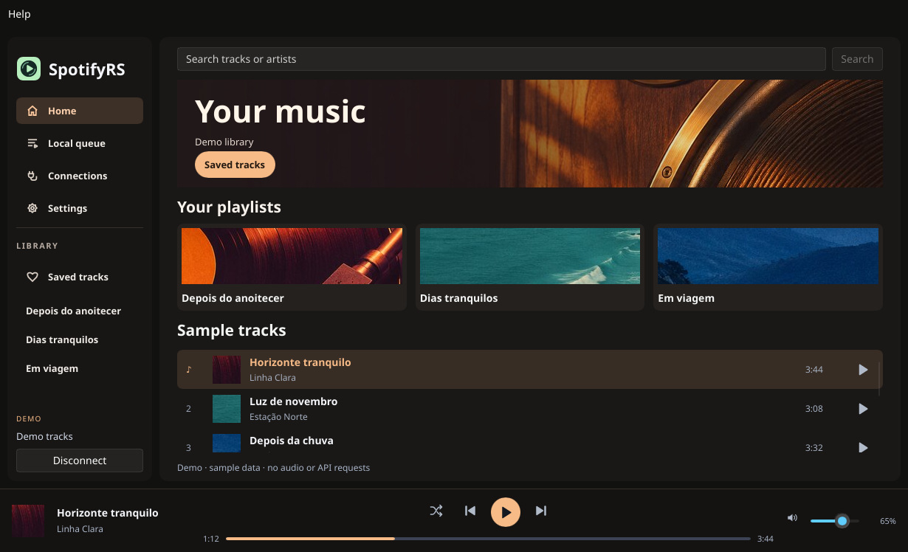

# SpotifyRS

Browse your Spotify library, choose what plays next, and control playback from a native desktop app for Windows and Linux. SpotifyRS is an independent, experimental project built with Rust and Slint. Its interface defaults to English and also supports European Portuguese.

[Download for Windows x64](https://github.com/omnizito/spotifyrs/releases/latest/download/SpotifyRS-Windows-x64.zip) · [Download the Linux AppImage](https://github.com/omnizito/spotifyrs/releases/latest/download/SpotifyRS-Linux-x86_64.AppImage) · [Build from source](#build-from-source) · [Set up playback](#set-up-playback)



## Try it in a minute

**Windows x64.** Extract the release ZIP and open `spotifyrs.exe`.

**Linux x86_64.** Download the AppImage, then run these commands in your download directory:

```sh
chmod +x SpotifyRS-Linux-x86_64.AppImage
./SpotifyRS-Linux-x86_64.AppImage --demo
```

If FUSE is unavailable, use `./SpotifyRS-Linux-x86_64.AppImage --appimage-extract-and-run --demo`.

Open **Connections → Try the demo**. Pick one of the three sample playlists, search for *Linha Clara*, or skip a track and watch the local queue change.

To change the language, open **Settings → App language**. SpotifyRS remembers your choice and shows the installed version under **Help → About**.

The demo is silent and works without a Spotify account. To hear music, choose where you want it to play.

## Set up playback

| Where you want to listen | What you need | What to do |
| --- | --- | --- |
| On this computer | The official Soloist executable and a Soloist key | Open **Connections**, enter the executable path and key, then select **Start and connect Soloist**. For the first pairing, select **SpotifyRS local** in Spotify’s device picker on the same network. |
| On a phone, speaker, or another computer | Spotify Premium, a Spotify developer app, and a Spotify Connect device | Start a track on the device. In SpotifyRS, enter your Client ID under **Connections**, choose **Connect via Web API**, then select the device and **Use device**. |

With Soloist connected, paste a Spotify track link into **Home** and choose **Play link**, or open **Local queue** to pick an upcoming track. If you want the app to activate this computer whenever it opens, enable **Start and activate Soloist on launch**. [Soloist setup guide (Portuguese)](outputs/SpotifyRS/SOLOIST.md)

### Bring in your library

In your Spotify developer app, register `http://127.0.0.1:8888/callback` as the redirect URI. Copy the **Client ID** to **Connections → Authorise library** and complete the sign-in in your browser. You can then browse saved tracks, search by title or artist, and explore playlists with their artwork. Spotify allows track listings for playlists you own or collaborate on. For other playlists, choose **Open in Spotify**. [Spotify Developer Dashboard](https://developer.spotify.com/dashboard)

SpotifyRS uses OAuth with PKCE. It stores refresh tokens in Windows Credential Manager or an unlocked Secret Service keyring on Linux. **Forget authorisation** removes the locally saved authorisation.

## Build from source

From the repository root, use a recent stable Rust toolchain. For Windows with MSVC, install Visual Studio Build Tools with the C++ tools and Windows SDK. On Linux, the build needs a C/C++ toolchain, pkg-config, and the OpenSSL and Fontconfig development packages. Run the app in an X11 or Wayland session.

```sh
cd outputs/SpotifyRS
cargo test --locked
cargo run --locked -- --demo
```

For an optimised binary, run `cargo build --release --locked` in the same directory.

**Arch Linux x86_64.** With `base-devel` installed, run the following from the repository root as a regular user. The package installs the `spotifyrs` command and a desktop menu entry.

```sh
cd outputs/SpotifyRS/packaging/arch
makepkg --syncdeps --install
spotifyrs --demo
```

## Project notes

- [Changelog](CHANGELOG.md)
- [Architecture (Portuguese)](outputs/SpotifyRS/ARCHITECTURE.md) covers the native interface, playback worker, and Spotify integrations.
- [Validation and measurements (Portuguese)](outputs/SpotifyRS/VALIDACAO.md) records which builds and scenarios were tested.
- The project code uses the [MIT license](LICENSE). Bundled dependencies have their own [third-party notices](outputs/SpotifyRS/THIRD_PARTY_NOTICES.md).
